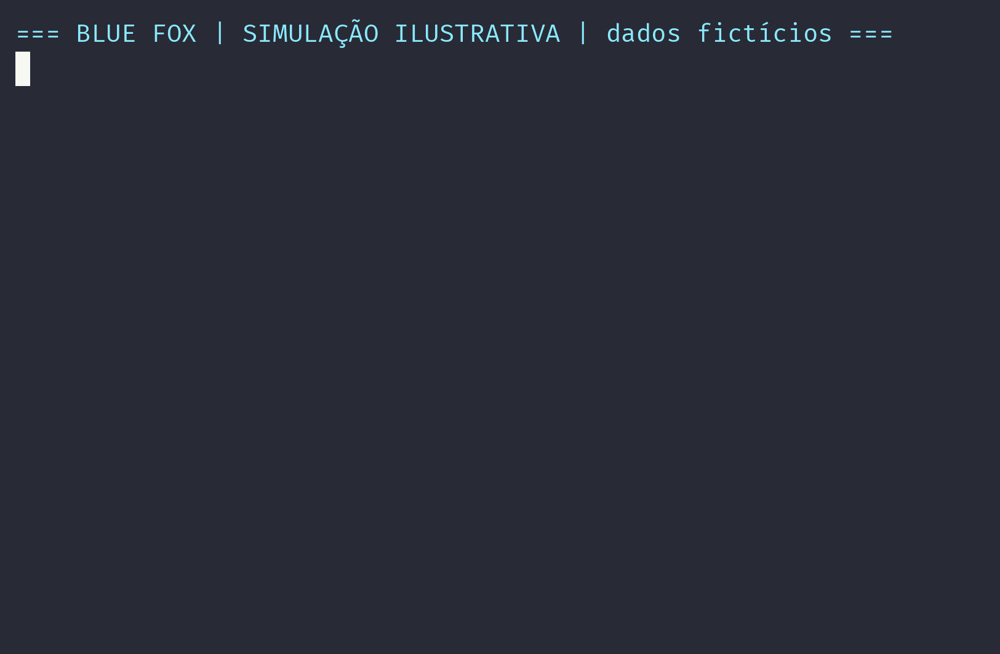

# 🛡️ Blue Team × Red Team: defesa de um alvo real por 7 dias

> **EN:** University security exercise. I acted alone as the Blue Team: I built, deployed and defended a real application exposed to the internet and to my class's red team for 7 days, covering cloud server, application, database, monitoring, incident response and documentation. No signs of compromise were found in the checks performed.

**Contexto:** exercício de segurança da faculdade (Análise e Desenvolvimento de Sistemas).

*Simulação ilustrativa: os dados do vídeo são fictícios.*

## 📌 O que eu fiz

Atuei sozinha como Blue Team: construí, publiquei e defendi uma aplicação real, exposta à internet e ao red team da turma, cuidando de:

- servidor em nuvem
- aplicação
- banco de dados
- monitoramento
- resposta a incidentes
- documentação

## 📊 Resultados do período (7 dias)

| Indicador | Resultado |
|---|---|
| Origens externas diferentes | 907 |
| Requisições vindas de fora | quase 5 mil |
| IPs hostis identificados e contidos | mais de 1.600 |
| Pedidos a caminhos sensíveis (arquivos de configuração e segredos) | 531 pedidos a 249 caminhos, **sem nenhum conteúdo entregue** |
| Tentativas de exploração via POST (path traversal e injeção de argumentos de PHP) | 77, **todas sem sucesso** |
| Sondagens de portas em um único dia | até 247 IPs diferentes |
| Ferramentas identificadas nos registros | gobuster, Nmap e vários scanners de internet |
| Sinais de invasão nas verificações | **nenhum** (sem execução de código, sem acesso administrativo, sem alteração de arquivos por terceiros) |

## 🎓 O que aprendi

- **Concluir só com evidência:** várias conclusões iniciais foram corrigidas depois de conferir os registros.
- **Fazer backup antes de cada mudança.**
- **O monitoramento também precisa ser monitorado.**
- **Separar os testes da própria equipe da atividade hostil**, para não misturar nas análises.

## ⚠️ Limitações

- Os registros não separam a atividade dos colegas do red team das varreduras da internet.
- A ausência de sinais de invasão nas verificações feitas **não prova** que nada ocorreu.
- Por segurança, detalhes de infraestrutura, defesas e dados de terceiros foram omitidos de propósito.

## 🎬 Simulação ilustrativa

O vídeo foi gerado com `asciinema` e `agg` a partir do script `simulacao.sh`, que imprime apenas linhas **fictícias**. Os dados do vídeo não representam registros reais.
